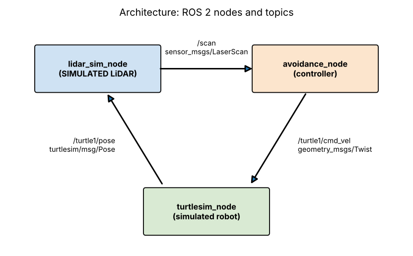

# ROS 2 Smart Obstacle Detection and Avoidance (Simulated)

A small ROS 2 (Python / `rclpy`) project in which a **simulated** mobile robot detects obstacles with a **simulated** LiDAR and automatically stops and turns to avoid them. No physical robot or real LiDAR hardware is used or required.



## How it works

| Node | Subscribes | Publishes | Job |
|---|---|---|---|
| `turtlesim_node` (from ROS) | `/turtle1/cmd_vel` | `/turtle1/pose` | The simulated robot and its window |
| `lidar_sim_node` | `/turtle1/pose` | `/scan` (`LaserScan`) | **Simulated** LiDAR: casts 37 rays (180° view, 3 m range) against virtual circular obstacles and the world walls |
| `avoidance_node` | `/scan` | `/turtle1/cmd_vel` (`Twist`) | Clear path: drive forward. Obstacle closer than 1.2 m in the front 60° cone: stop and turn toward the more open side. Resume once the front is clear beyond 1.6 m (hysteresis avoids jitter) |

Obstacles are virtual circles listed in `smart_obstacle_avoidance/core.py`; the launch file draws them as parked turtles so you can see them. The sensing and decision logic lives in `core.py` (no ROS imports), so it is unit-testable.

## Project layout

```
smart_obstacle_avoidance/   core.py (logic), lidar_sim_node.py, avoidance_node.py
launch/avoidance.launch.py  starts everything
config/params.yaml          distances, speeds, beam count
test/test_core.py           unit tests (pytest)
scripts/                    offline_demo.py (no ROS), make_diagram.py
docs/                       architecture.png, simulation_demo.png, sample_output.txt
```

## Installation (Ubuntu 22.04 + ROS 2 Humble, or Ubuntu 24.04 + ROS 2 Jazzy)

1. Install ROS 2 following the [official guide](https://docs.ros.org/) (desktop install), then:
   ```bash
   sudo apt install ros-$ROS_DISTRO-turtlesim python3-colcon-common-extensions
   ```
2. Build:
   ```bash
   mkdir -p ~/ros2_ws/src && cd ~/ros2_ws/src
   git clone <this-repo-url> smart_obstacle_avoidance
   cd ~/ros2_ws && source /opt/ros/$ROS_DISTRO/setup.bash
   colcon build --packages-select smart_obstacle_avoidance
   source install/setup.bash
   ```

## Run

```bash
ros2 launch smart_obstacle_avoidance avoidance.launch.py
```
The turtle drives forward, and the terminal prints lines like `front=1.19 m left=3.00 m right=0.79 m | cmd: v=0.0 w=+1.5 | OBSTACLE at 1.19 m -> stop, turning left`.

Inspect the topics in another terminal: `ros2 topic echo /scan --once`, `ros2 topic hz /scan`, `rqt_graph`.

## Tests

```bash
python3 -m pytest test            # logic tests, no ROS needed
python3 scripts/offline_demo.py   # offline simulation, regenerates docs/simulation_demo.png
```

## Verification status (honest summary)

| Item | Status |
|---|---|
| Core logic (ray casting, avoidance decisions) | **Tested**: 8 unit tests pass |
| Offline simulation of the same logic (60 s run, 0.26 m minimum clearance, no collision) | **Run**; output in `docs/sample_output.txt` |
| ROS 2 nodes, launch file, Turtlesim window | **Written but not executed**: ROS 2 was not available in the build environment. Please run the launch command once on a ROS 2 machine, and fix anything that surfaces, before presenting it as tested |

`docs/simulation_demo.png` comes from the offline matplotlib simulation, **not** a Turtlesim screenshot. Add your own screenshots of the Turtlesim window and terminal after your first run.

## Limitations

2D simulation only; circular obstacles; simple reactive logic (no mapping or planning); the turtle's motion model is Turtlesim's, not a physics engine.

## License
MIT
